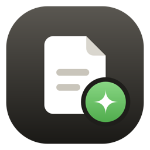
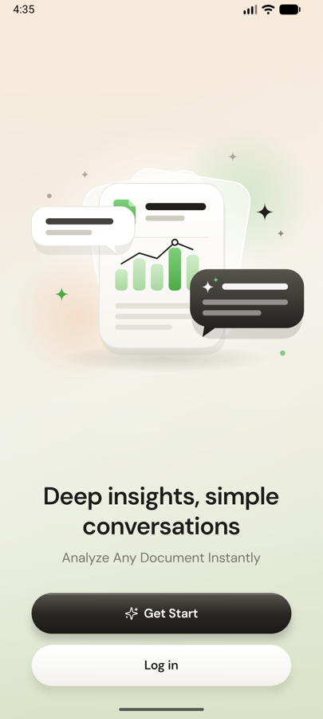
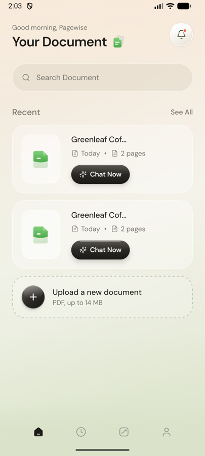
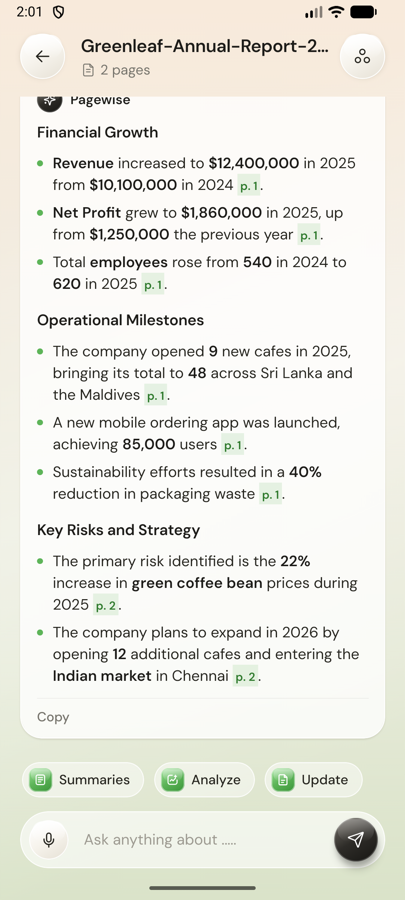
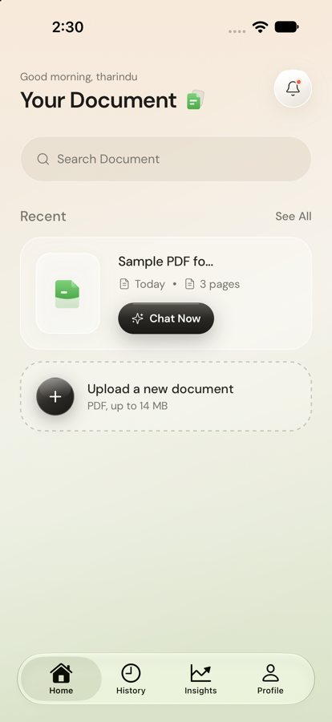
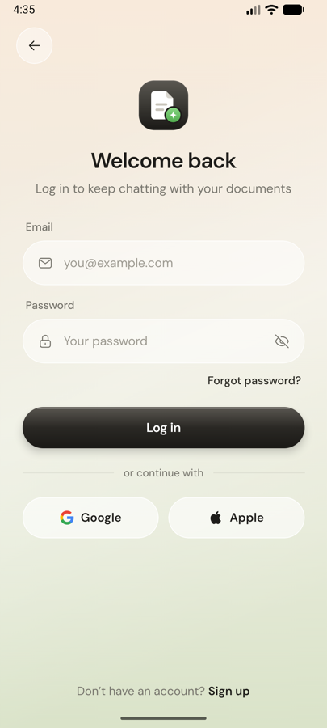
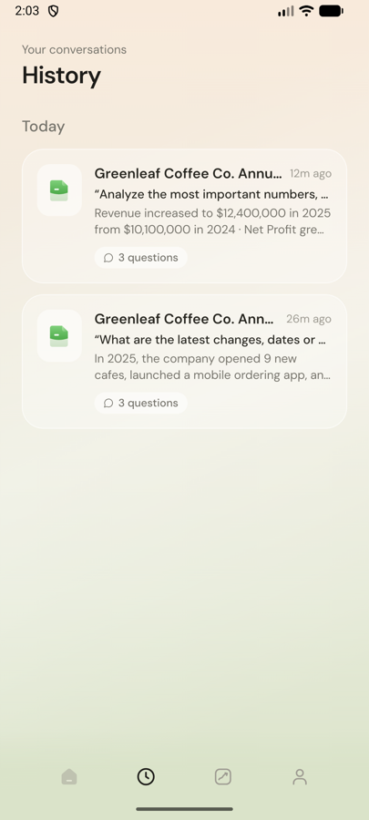
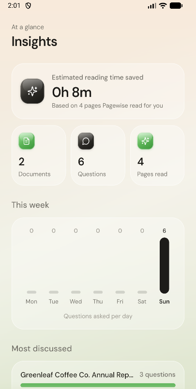
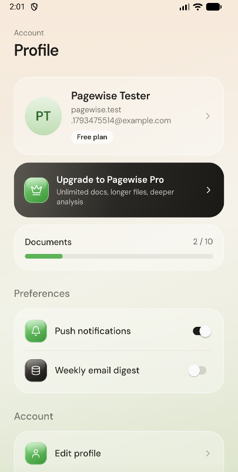

<div align="center">



# Pagewise

**Deep insights, simple conversations.**
Upload a PDF and chat with it: Pagewise reads the whole document with Google Gemini, summarizes it,
and answers your questions with page references.

Expo · React Native · TypeScript · Firebase · Gemini

</div>

---

## Screenshots

<table>
  <tr>
    <td align="center"><br /><sub>Welcome</sub></td>
    <td align="center"><br /><sub>Your documents</sub></td>
    <td align="center"><br /><sub>Chat with a PDF</sub></td>
    <td align="center"><br /><sub>iOS · Liquid Glass tab bar</sub></td>
  </tr>
  <tr>
    <td align="center"><br /><sub>Sign in</sub></td>
    <td align="center"><br /><sub>History</sub></td>
    <td align="center"><br /><sub>Insights</sub></td>
    <td align="center"><br /><sub>Profile</sub></td>
  </tr>
</table>

## Features

- 📄 **Upload any PDF** (up to 14 MB). Gemini reads it and writes a title, summary and key highlights.
- 💬 **Ask questions** and get answers that stream in live, formatted with bullets, **bold** figures and page tags like `p. 4`.
- ⚡ **Quick actions**: Summaries, Analyze, Update.
- 🎙️ **Voice typing**: tap the mic and speak your question.
- 🕘 **History & Insights**: past conversations, questions per day, most-discussed documents.
- 🔐 **Accounts**: email/password, Google, and Sign in with Apple (iOS). Password reset included.
- 🛡️ **Secure by default**: Firestore rules isolate each user's data, and App Check protects the Gemini quota.
- 🍎 **Native feel**: Liquid Glass tab bar on iOS 26+, custom glass design on Android, edge-to-edge keyboard handling.

## Quick start

> New to React Native? Follow the full step-by-step guide: **[docs/getting-started.md](docs/getting-started.md)**.

```bash
# 1. Install dependencies
npm install

# 2. Connect your Firebase project (see docs/firebase-setup.md), then:
cp .env.example .env              # fill in the two values
#    and add google-services.json + GoogleService-Info.plist to the project root

# 3. Build and run (an emulator/simulator must be open)
npm run android                   # or: npm run ios  (macOS only)

# Afterwards, for day-to-day work with live reload:
npm start
```

Pagewise uses native modules, so it runs as a **development build**, not in Expo Go.

## Documentation

| Guide | What's inside |
|---|---|
| [Getting started](docs/getting-started.md) | Install the tools, run on Android & iOS, everyday commands |
| [Firebase setup](docs/firebase-setup.md) | Click-by-click: Auth, Firestore, Gemini (AI Logic), App Check, `.env` |
| [Architecture](docs/architecture.md) | Folder structure, data model, how upload & chat work, security |
| [Troubleshooting](docs/troubleshooting.md) | Fixes for common errors (App Check, Kotlin, keychain, Gemini…) |

## Project structure

```
src/
├── app/          # Screens (Expo Router: every file is a route)
├── components/   # ui/, layout/, chat/, document/, illustrations/
├── state/        # Auth + library (documents, chats, Gemini) providers
├── lib/          # Firebase, App Check and Gemini setup
├── hooks/        # useVoiceInput
├── constants/    # Theme and plan limits
├── types/        # Shared types
└── utils/        # Formatting and validation helpers
```

Details: [docs/architecture.md](docs/architecture.md).

## Scripts

| Command | Description |
|---|---|
| `npm start` | Dev server with live reload |
| `npm run android` | Build & run on Android |
| `npm run ios` | Build & run on iOS (macOS) |
| `npm run typecheck` | TypeScript check |
| `npm run prebuild` | Regenerate native `android/` & `ios/` folders |
| `npm run doctor` | Diagnose Expo setup issues |

## Roadmap

- [ ] In-app purchases for Pagewise Pro (needs a server webhook to set the plan)
- [ ] Cloud storage for PDFs (sync files across devices; needs Firebase Blaze)
- [ ] Render real PDF pages in the document view
