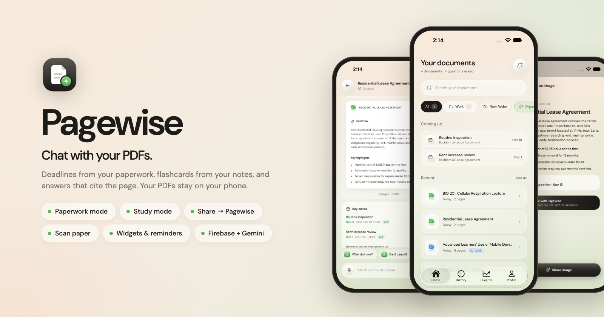

<div align="center">



<br />

**Pagewise** lets you upload, share or scan a PDF and chat with it. It reads the whole document with Google Gemini,
summarizes it, and answers your questions with page references. Paperwork gets its deadlines, amounts and risky
clauses pulled out; study material gets flashcards and quizzes. The PDFs themselves stay on your phone.

Expo · React Native · TypeScript · Firebase · Gemini

</div>

---

## Features

- 📄 **Upload any PDF** (up to 14 MB). Gemini reads it and writes a title, summary and key highlights.
- 📤 **Share → Ask Pagewise** from Mail, Files, WhatsApp or any app: the PDF opens in Pagewise and is read straight away.
- 📷 **Scan paper** with the camera (VisionKit / ML Kit). Pages become a PDF Gemini can read.
- 🧾 **Paperwork mode**: for contracts, leases, bills and letters, Pagewise pulls out **key dates**, **amounts** and **clauses worth a closer look**. Add dates to your calendar, get reminded 3 days before.
- 🎓 **Study mode**: for notes, slides and papers, make **flashcards** with spaced repetition, or take a fresh **quiz**.
- 🔎 **Real PDF viewer**: tap any page tag (`p. 4`) to open that page.
- 🔊 **Listen**: a spoken briefing of the summary, key points and next deadline.
- 🖼️ **Share as image**: a branded summary card for messages and socials.
- 📱 **Home-screen widgets** (iOS + Android, plus the iOS lock screen): upcoming deadlines and flashcards due.
- 💬 **Ask questions** and get answers that stream in live, formatted with bullets, **bold** figures and page tags like `p. 4`.
- ⚡ **Quick actions**: Summaries, Analyze, Update.
- 🗂️ **Folders**: create folders and move documents into them, or let **Organize with AI** propose folders for you to review and apply.
- 🎙️ **Voice typing**: tap the mic and speak your question.
- 🕘 **History & Insights**: past conversations, questions per day, most-discussed documents.
- 🔐 **Accounts**: email/password, Google, and Sign in with Apple (iOS). Password reset included.
- 🔒 **Private by design**: PDFs are stored only on the phone. Reminders and widgets are created on the device.
- 🛡️ **Secure by default**: Firestore rules isolate each user's data, and App Check protects the Gemini quota.
- 🍎 **Native feel**: Liquid Glass tab bar on iOS 26+, custom glass design on Android, edge-to-edge keyboard handling.

## Quick start

> New to React Native? Follow the full step-by-step guide: **[docs/getting-started.md](docs/getting-started.md)**.

```bash
# 1. Install dependencies
npm install

# 2. Connect your Firebase project (see docs/firebase-setup.md), then:
cp .env.example .env              # fill in the two values
#    and add google-services.json + GoogleService-Info.plist to the project root

# 3. Build and run (an emulator/simulator must be open)
npm run android                   # or: npm run ios  (macOS only)

# Afterwards, for day-to-day work with live reload:
npm start
```

Pagewise uses native modules, so it runs as a **development build**, not in Expo Go.

## Documentation

| Guide | What's inside |
|---|---|
| [Getting started](docs/getting-started.md) | Install the tools, run on Android & iOS, everyday commands |
| [Firebase setup](docs/firebase-setup.md) | Click-by-click: Auth, Firestore, Gemini (AI Logic), App Check, `.env` |
| [Architecture](docs/architecture.md) | Folder structure, data model, how upload & chat work, security |
| [Troubleshooting](docs/troubleshooting.md) | Fixes for common errors (App Check, Kotlin, keychain, Gemini…) |

## Project structure

```
src/
├── app/          # Screens (Expo Router: every file is a route)
├── components/   # ui/, layout/, chat/, document/, illustrations/
├── state/        # Auth + library (documents, chats, Gemini) providers
├── lib/          # Firebase, App Check and Gemini setup
├── hooks/        # useVoiceInput
├── constants/    # Theme and plan limits
├── types/        # Shared types
└── utils/        # Formatting and validation helpers
```

Details: [docs/architecture.md](docs/architecture.md).

## Scripts

| Command | Description |
|---|---|
| `npm start` | Dev server with live reload |
| `npm run android` | Build & run on Android |
| `npm run ios` | Build & run on iOS (macOS) |
| `npm run typecheck` | TypeScript check |
| `npm run prebuild` | Regenerate native `android/` & `ios/` folders |
| `npm run doctor` | Diagnose Expo setup issues |

## Roadmap

- [ ] In-app purchases for Pagewise Pro (needs a server webhook to set the plan)
- [ ] Cloud storage for PDFs (sync files across devices; needs Firebase Blaze)
- [x] Render real PDF pages in the document view
- [ ] On-device AI (Apple Foundation Models / Gemini Nano) for fully offline summaries
